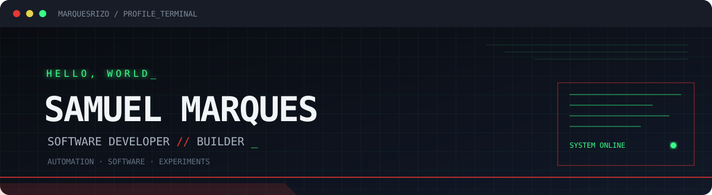
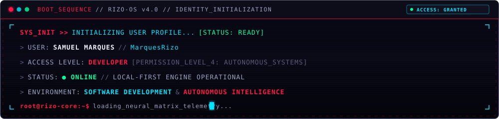
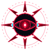

<!--
  ═════════════════════════════════════════════════════════════════════════
  SAMUEL MARQUES // MARQUESRIZO
  Visual Identity: R.I.Z.O. — Rede Integrada de Inteligência e Operações
  Theme: Cyberpunk Neural Matrix (v4.0)
  Palette: #04040a (Base) | #ff1744 (Neon Red) | #00e5ff (Cyber Cyan) | #00ff9d (Matrix Green)
  ═════════════════════════════════════════════════════════════════════════
-->

<div align="center">

<!-- Hero Banner Principal com Logo Oficial R.I.Z.O. -->


<br/><br/>

<!-- System Quick-Status Telemetry Badges -->
[](https://github.com/MarquesRizo)
[](https://github.com/MarquesRizo/R.I.Z.O)
[](https://github.com/MarquesRizo)
[](https://github.com/MarquesRizo)

</div>


### 🖥️ `// INICIALIZAÇÃO_DO_SISTEMA: terminal_boot`

<div align="center">

</div>

<br/>

<details>
<summary><b>[+] EXPANDIR REGISTRO TEXTUAL DE TELEMETRIA</b></summary>

```ansi
 [BOOT_SEQUENCE] Conexão neural estabelecida com MarquesRizo/Core...
 ──────────────────────────────────────────────────────────────────────────────
  INITIALIZING USER PROFILE...   [STATUS: READY]
  USER:                          SAMUEL MARQUES // MarquesRizo
  ACCESS LEVEL:                  DEVELOPER [CLEARANCE_LEVEL_4]
  STATUS:                        ● ONLINE // SOVEREIGN ENGINE ACTIVE
  ENVIRONMENT:                   SOFTWARE DEVELOPMENT & AUTONOMOUS INTELLIGENCE
 ──────────────────────────────────────────────────────────────────────────────
```
</details>


### 🧬 `// DIRETRIZES & ARQUITETURA COGNITIVA: about_me`

> Sou estudante de **Ciência da Computação** e desenvolvedor orientado à construção de sistemas robustos, inteligência artificial e arquiteturas soberanas. Tenho fascínio em explorar ideias do zero, resolver problemas de engenharia e transformar conceitos abstratos em sistemas funcionais e elegantes.

<table>
  <tr>
    <td width="50%" valign="top">
      <h4>⚡ Desenvolvimento de Software &amp; Sistemas</h4>
      <p>Construção de aplicações escaláveis, ferramentas nativas de linha de comando (CLI) de alta resposta, automações e estruturas resilientes de código.</p>
    </td>
    <td width="50%" valign="top">
      <h4>🤖 Inteligência Artificial &amp; Sistemas Autônomos</h4>
      <p>Desenvolvimento e orquestração de agentes cognitivos, motores de memória persistente, RAG local e arquiteturas de execução orientadas a ferramentas.</p>
    </td>
  </tr>
  <tr>
    <td width="50%" valign="top">
      <h4>🏛️ Arquitetura de Software &amp; Automação</h4>
      <p>Engenharia de software focada em modularidade, princípios de segurança rigorosos (controle de permissões, fail-closed) e pipelines eficientes.</p>
    </td>
    <td width="50%" valign="top">
      <h4>👁️ Criação de Projetos Próprios &amp; Interfaces</h4>
      <p>Concepção de soluções completas — do backend de execução e bancos de dados até dashboards táteis cyberpunk com visualização de redes e HUDs futuristas.</p>
    </td>
  </tr>
</table>


### ⚡ `// MATRIZ_TECNOLÓGICA & ARSENAL: tech_stack`

<div align="center">

<!-- Linguagens Principais -->
<h4>Linguagens de Programação</h4>

[](https://python.org)
[](https://en.wikipedia.org/wiki/C_(programming_language))
[](https://isocpp.org)
[](https://developer.mozilla.org/en-US/docs/Web/JavaScript)
[](https://openjdk.org)

<br/>

<!-- Web, Bancos de Dados & Infraestrutura -->
<h4>Web, Bancos de Dados &amp; Sistemas</h4>

[](https://developer.mozilla.org)
[](https://developer.mozilla.org)
[](https://mysql.com)
[](https://sqlite.org)
[](https://git-scm.com)

</div>


### 🏆 `// NÚCLEO_OPERACIONAL: Projeto em Destaque`

<div align="center">

  <a href="https://github.com/MarquesRizo/R.I.Z.O">
    
  </a>

  <h3><a href="https://github.com/MarquesRizo/R.I.Z.O">R.I.Z.O. — Rede Integrada de Inteligência e Operações</a></h3>
  <p><strong>Agente de Inteligência Artificial Soberano &amp; Modular com Interface Cibernética</strong></p>

[](https://github.com/MarquesRizo/R.I.Z.O)
[](https://github.com/MarquesRizo/R.I.Z.O)
[](https://github.com/MarquesRizo/R.I.Z.O)

</div>

> *“O R.I.Z.O. é o núcleo central do meu ecossistema de desenvolvimento. Um projeto pessoal em constante evolução, construído para aprender continuamente, persistir memória episódica em grafos e orquestrar ferramentas com segurança e interface imersiva.”*

#### ⚙️ Características &amp; Módulos Implementados:
- 🧠 **Grafo de Conhecimento & Memória Semântica**: Banco SQLite local transacional com persistência em WAL e conexões conceituais indexadas.
- 🛡️ **Segurança Estrita em 4 Níveis (L1–L4)**: Barramento centralizado de permissões com tokens de uso único, vinculação canônica de parâmetros e auditoria fail-closed.
- 🌐 **Painel Visual HUD Cyberpunk**: Interface web com matriz neural interativa, telemetria em tempo real e visualização de nós semânticos.
- 🖥️ **CLI Tátil & Terminal**: Console interativo inteligente com comandos de diagnóstico, busca contextual e suporte a LLMs locais com fallback heurístico.


### 📊 `// TELEMETRIA_GITHUB: estatísticas_operacionais`

<div align="center">


<br/><br/>


</div>


### 📡 `// UPLINK_DE_SINAL & CONTATO`

<div align="center">

[](mailto:samuelmarques.dev@gmail.com)
[](https://github.com/MarquesRizo)
[](https://linkedin.com/in/)

<br/><br/>


<br/>

```text
[CONNECTION ESTABLISHED] // [SYSTEM ONLINE] // END OF LINE_
```

<sub><code>OPERATIONAL DISPATCH // MARQUESRIZO CORE INTELLIGENCE // SOVEREIGN SYSTEMS BY DESIGN</code></sub>

</div>
